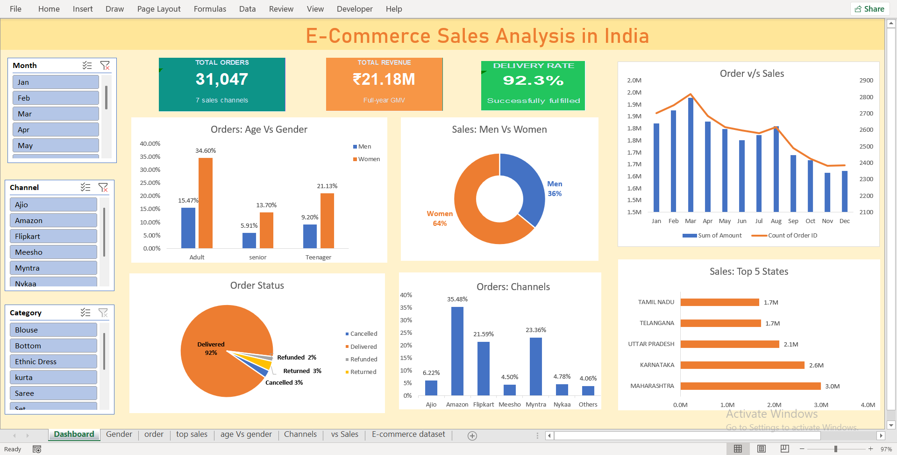

# E-Commerce Sales Dashboard (Excel)

**An Excel dashboard on 31,047 order lines showing which channels, states and customers bring in the sales.**

## The question
Where do sales come from by channel, state and customer segment?

## The data
- Public e-commerce sales dataset from Kaggle: **[add dataset name and link]**
- 31,047 order lines covering 28,471 unique order IDs (some orders have several lines)
- Total sales: 21.2 million (currency not stated in the dataset)
- Order status: Delivered 28,641, Returned 1,045, Cancelled 844, Refunded 517

## Tools
Excel: PivotTables, slicers, charts, data cleaning

## Key findings
| Metric | Result |
|---|---|
| Amazon share of sales | 35.5% |
| Myntra share of sales | 23.3% |
| Flipkart share of sales | 21.6% |
| Top state: Maharashtra | 14.1% of sales |
| Second state: Karnataka | 12.5% of sales |
| Sales from women customers | 64.0% |
| Top category: Set | 49.6% of sales |

The channel and state rankings stay the same when cancelled, returned and refunded orders are removed.

## Data notes and limits
- The dashboard totals include cancelled, returned and refunded lines, which make up 7.4% of the sales amount. Delivered-only sales are 19.7 million.
- Counts of Order ID in the pivots count order *lines*, not unique orders.
- The Date column has only 36 distinct dates and shows months January to December. It looks like day and month were swapped when the file was loaded, so **I did not use a month-by-month trend**.

## Files
- [E Commerce sales analysis.xlsx](E%20Commerce%20sales%20analysis.xlsx) - the workbook
- [Excel_Dashboard.png](Excel_Dashboard.png) - dashboard preview
