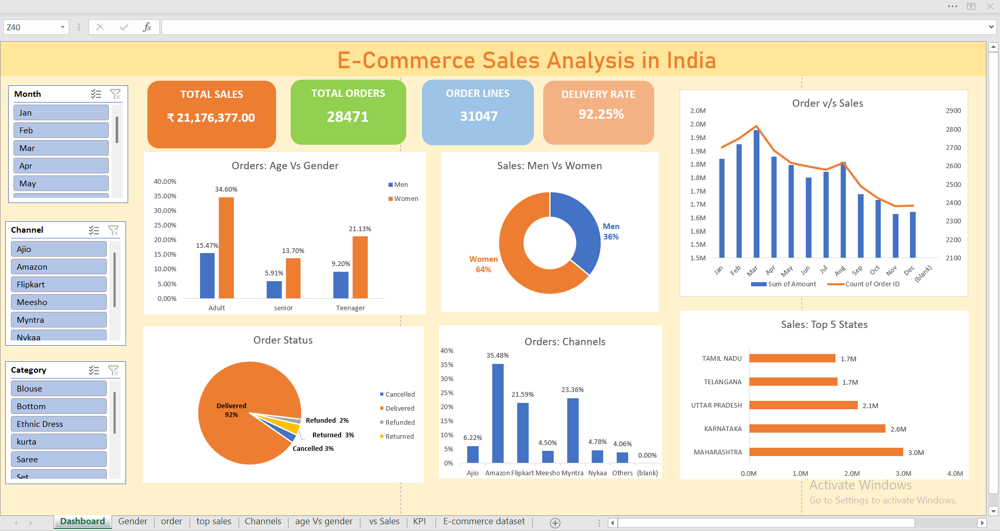

# E-Commerce Sales Dashboard (Excel)

**Three marketplaces bring in 80% of the sales, women buy 64% of it, and about 7% of sales value is lost to returns, cancellations and refunds. I built an interactive Excel dashboard on 31,047 order lines of Indian clothing e-commerce data to find this out.**

## The questions
1. Which customers bring in the most sales?
2. Which sales channels perform best?
3. Which states generate the most revenue?
4. How much revenue is lost after the order is placed?

## The data
- Public e-commerce sales dataset from Kaggle: **31,047 order lines** covering **28,471 unique orders**, 28,437 customers, 35 states and union territories.
- Each row is one product on an order. An order with two products takes two rows, so the dashboard shows 31,047 **order lines**, not orders.
- Columns: order ID, customer ID, gender, age, date, status, channel, SKU, category, size, quantity, amount (₹), city, state, B2B flag.
- Total sales: **₹21.18M**.

## What I built
- Added an age-group column (18-29, 30-49, 50+) and a month column with Excel formulas.
- Built 6 PivotTables and 6 dashboard charts: age vs gender, sales by gender, order status, channels, top states, orders vs sales.
- Added three slicers (month, channel, category) so the whole dashboard filters at once.
- Set up three KPI cards: order lines, total sales, delivery rate.
- Wrote up the findings as an 11-slide presentation.

## Key findings
| What | Result |
|---|---|
| Total sales | ₹21.18M across 31,047 order lines |
| Delivery rate | 92.3% of lines delivered (returned 3.4%, cancelled 2.7%, refunded 1.7%) |
| Sales lost to returns, cancellations, refunds | ₹1.47M (6.9%). Delivered-only sales: ₹19.71M |
| Top 3 channels | Amazon 35.5%, Myntra 23.3%, Flipkart 21.6%: together **80.4%** of sales |
| Smaller channels | Ajio 6.3%, Nykaa 4.8%, Meesho 4.4%, Others 4.1% |
| Top 3 states | Maharashtra 14.1% (₹2.99M), Karnataka 12.5% (₹2.65M), Uttar Pradesh 9.9% (₹2.10M): **36.6%** together |
| Customers | Women 64.0% of sales, men 36.0% |
| Top 3 categories | Set 49.6%, Kurta 23.4%, Western Dress 14.9%: **87.9%** together |
| Age | 30-49 year olds place 50.1% of orders, 18-29 place 30.3%, 50+ place 19.6% |

Two things I found underneath the headline numbers:
- **Women place more orders, men spend more per order.** Women are 69% of order lines but 64% of sales. The average line is ₹802 for men and ₹629 for women.
- **No channel stands out on lost orders.** The share of returned, cancelled or refunded lines runs from 6.8% to 8.1% across all seven channels, so the 7% loss is a platform-wide pattern, not one bad channel.

The rankings hold up when I take out the cancelled, returned and refunded orders. The channel order is identical. The top 3 states are identical too, and Telangana and Tamil Nadu (4th and 5th) swap places at 8.0% each.

## What I would do with this
- **Treat Amazon, Myntra and Flipkart as the business.** Four out of five rupees come from them, so a change on any one of them moves the total.
- **Look at the ₹1.47M lost after checkout.** Returns are the biggest part (₹0.72M), then cancellations (₹0.48M) and refunds (₹0.26M). Since all channels sit at 7-8%, start with the causes (product, size, delivery), not with a single channel.
- **Market to women, and look at men's higher order value.** Women drive most of the sales, but men's orders are about 27% larger.
- **Focus on Maharashtra and Karnataka**, and check whether the Set and Kurta ranges are stocked in the next-biggest states.

## Data limits
- **Order dates are unreliable.** Every order falls on just 36 dates: the 4th, 5th or 6th of each month from January to December 2022. That pattern looks like day and month were swapped when the file was loaded. I did not draw any conclusions from monthly trends, and the dashboard's month slicer and "Order v/s Sales" chart should be read as a layout demo, not a sales trend.
- **Order counts are order lines, not orders.** 31,047 lines belong to 28,471 orders.
- **State names have mixed capitalisation** (for example Delhi, DELHI, delhi, and New Delhi). The rankings above merge them (50 spellings become 35 states).
- **B2B orders are only 0.6% of sales**, so I did not split them out.
- The data is one snapshot with no cost or profit figures, so this is a sales analysis, not a profit analysis.

## Files
- [E Commerce sales analysis.xlsx](E%20Commerce%20sales%20analysis.xlsx): the dashboard, pivots and cleaned dataset
- [Excel_Dashboard.png](Excel_Dashboard.png): dashboard screenshot
